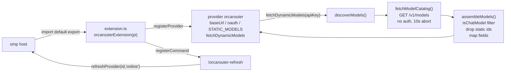

# Repository Guidelines

## Project Overview

An omp (Oh My Pi) **provider plugin**, not a standalone app. It registers the provider id `orcarouter` against OrcaRouter's OpenAI-compatible API, discovers the live model catalog from `GET /v1/models`, and maps each row into omp `ProviderModelConfig` metadata: context window, output cap, image input, USD-per-million prices, and a reasoning/thinking profile inferred from the model id. Ships as source only — omp imports `src/extension.ts` with its own embedded Bun, so there is no build step and no runtime dependency.

## Architecture & Data Flow

Two modules with a hard split: `src/catalog.ts` is pure data/logic (no side effects, no globals beyond `process.env`); `src/extension.ts` is the only place that touches the omp host API.



Data flow details that constrain any change:

- The catalog request is deliberately **credential-free**. `fetchModelCatalog(_apiKey, fetchImpl)` ignores the key because OrcaRouter rejects a stale bearer with HTTP 401; the test asserts no `authorization` header. Do not "fix" the unused parameter.
- `_apiKey` is still part of the signature because omp passes it; a `fetchImpl` last parameter exists so tests inject a fake instead of mocking modules.
- Catalog rows are filtered twice: `isChatModel` (must expose the exact `"openai"` endpoint type and must not match the `NON_CHAT_ID` regex), then `assembleModels` drops ids already covered by `STATIC_MODELS` (`orcarouter/auto`, `orcarouter/free`).
- No caching, retry, or persistence here. The 24 h SQLite model cache and forced refresh live in omp; `"online"` is handed to `refreshProvider`.
- Discovery **throws** rather than returning an empty list (`OrcaRouter returned no chat-capable models`), so a broken upstream never silently wipes the model picker.

## Key Directories

| Path | Purpose |
|---|---|
| `src/` | Plugin source. `extension.ts` = entry point; `catalog.ts` = fetch + mapping logic. |
| `test/` | Single Bun test file covering both modules. Inline fixtures only; no fixture directory. |
| `.omp-plugin/` | Marketplace manifest (`marketplace.json`) for `omp plugin install`. Not part of the npm `files` list. |
| `.devcontainer/` | Dev container: `Dockerfile` (Bun 1.4.3, pre-creates the bun-owned `node_modules` mountpoint so a fresh named volume needs no chown) and `devcontainer.json` (non-root `bun` user, `updateContentCommand` install, named volume). All dev-time gates run here. |

## Development Commands

```bash
# one-time: build the dev container; updateContentCommand installs devDependencies
# into the named node_modules volume before up returns
./scripts/dc up

# tests and gates, all inside the container (Bun 1.4.3, same as CI)
./scripts/dc exec bun test
./scripts/dc exec bun run typecheck
./scripts/dc exec bun run lint
./scripts/dc exec bun run check   # typecheck + lint in one gate

# host-only: load the checkout into omp as a linked plugin, then restart omp
omp plugin link ~/src/omp-orcarouter

# host-only: probe the live public catalog without touching user state or the model cache
ORCAROUTER_API_KEY=sk-orca-verification-dummy \
PI_CODING_AGENT_DIR="$(mktemp -d)" \
omp models orcarouter --json -e ./src/extension.ts --no-extensions

# host-only: real inference (needs a real key from /login or env)
omp -p --model orcarouter/openai/gpt-4o "Reply with OK"
```

- The host has `omp` and `docker` but no standalone `devcontainer` CLI, `bun`, `node`, `tsc`, or `biome`; every dev-time gate runs in the dev container through `scripts/dc`, which runs the official `@devcontainers/cli` in a cached helper image so no host installs are needed. Bun 1.4.3 comes from the container image (`.devcontainer/Dockerfile`), pinned to match `packageManager` and CI, and `node_modules` lives in the named Docker volume `omp-orcarouter-node_modules`, so dependencies never land in the checkout (Docker does create an empty, gitignored `node_modules/` mountpoint there on container start).
- `bun run <script>` inside the container is the only supported way to run the `package.json` scripts. The gates are `tsc --noEmit` and `biome check`, both from dev-only `devDependencies`; CI (`.github/workflows/ci.yml`) uses real Bun 1.4.3 and `bun install --frozen-lockfile`. There is still no build step and no runtime dependency.
- `omp` embeds Bun (`BUN_BE_BUN=1` re-execs it in Bun-CLI mode), which is why the host binary can load `src/extension.ts` with no install; it is not a gate runner and must not be documented as one.
- Selectors double the provider prefix because OrcaRouter ids already carry one: `orcarouter/openai/gpt-5.5` selects model `openai/gpt-5.5`.

## Code Conventions & Common Patterns

- **Formatting**: tabs, double quotes, semicolons, trailing commas — the Biome defaults, enforced by `biome.json`.
- **Imports**: explicit `.ts` extensions (`./catalog.ts`); host types via `import type { … } from "@oh-my-pi/pi-coding-agent"` (type-only — it is a dev-only dependency for declarations and is never a runtime dependency).
- **Module shape**: `SCREAMING_SNAKE` constants at the top of `catalog.ts` (ids, env var names, defaults, timeout, exclusion regex), exported pure functions below, private helpers after their public callers. `extension.ts` holds exactly one default export and no logic of its own beyond wiring.
- **Naming**: `is*` for type guards that narrow (`isChatModel`), `isOpenAIReasoningId` for the narrower compat subset, `*For` for metadata derivation (`thinkingFor`), `build*`/`assemble*` for pure constructors.
- **Error handling**: throw `Error` with a provider-prefixed message (`OrcaRouter model discovery failed: HTTP ${status}`). Filter bad input silently (malformed rows, non-chat ids); throw only when the result would be unusable. Env reads trim and fall back via `||`, returning `undefined` when unset — never `""`.
- **Side effects** live only in `extension.ts`; everything in `catalog.ts` takes its inputs as arguments. Keep it that way so mapping stays testable without omp.
- **Dependency injection over mocking**: functions that do I/O accept the last parameter (`fetchImpl: typeof fetch = fetch`). Tests pass `fakeFetch`, never `mock.module`.
- **Comments** explain only non-obvious *why* (why no auth header, why the float round at `1e12`). No narration.
- **Numeric hygiene**: prices are USD per million tokens; per-token values multiply by `1_000_000`, prefer `*_per_million` fields when present, round at `1e12` to drop binary-float dust.
- **Invariants that must survive edits**: `maxTokens` clamped to `contextWindow`; `apiBaseV1()` appends `/v1` at most once and strips trailing slashes; `reasoning` is inferred from the id (fix the heuristics in `isReasoningModel`/`isOpenAIReasoningId`, never hardcode per-model flags); every reasoning model gets a `thinking` effort profile and OpenAI reasoning ids also disable sampling/penalty params. `thinkingFor` emits effort ladders only through the `efforts()` bridge at the top of `catalog.ts` — the host's `Effort` is an ambient const enum, so never replace the bridge with a bare string array, a value import of the host package, or a per-ladder cast; tests read compat through the `compatValue` helper for the same reason.
- **Reasoning heuristics** are the most fragile surface: substrings in `isReasoningModel` (`/o[1-9](-|$)/`, `gpt-5`, `gemini-3`, `glm-4.6`, `fusion`, …). Extend the list, keep the qwen3 `instruct` exclusion, and update README's override example when behavior changes.

## Important Files

| File | Role |
|---|---|
| `src/extension.ts` | Default-export entry: `registerProvider` (base URL, `api: "openai-completions"`, optional env key, `oauth.login` secret prompt, static models, `fetchDynamicModels`) and `registerCommand("orcarouter-refresh")`. Registered by `package.json` → `omp.extensions`. |
| `src/catalog.ts` | Constants, `OrcaRouterModel` raw-row type, `apiBaseV1`, `envApiKey`, filters, reasoning/compat/price mapping, `STATIC_MODELS`, `fetchModelCatalog`, `discoverModels`. |
| `test/orcarouter.test.ts` | All tests. `fakeFetch`, `row()`, `compatValue()`, `loadExtension()` helpers. |
| `package.json` | Manifest; `omp.extensions` is the load hook; scripts: `test`, `typecheck`, `lint`, `format`, `check`; `devDependencies` are dev-only. |
| `tsconfig.json` | Typecheck settings: ESNext, `moduleResolution: "bundler"`, `allowImportingTsExtensions` (imports name `.ts` files), `noEmit`, `strict`, `skipLibCheck`, `types: ["bun"]`; includes `src/**/*.ts` + `test/**/*.ts`. |
| `biome.json` | Lint/format config pinned to the repo's existing style (tabs, double quotes, semicolons, trailing commas, 80 columns). JSON files sit outside `files.includes` on purpose. |
| `.github/workflows/ci.yml` | CI job: Bun 1.4.3, `bun install --frozen-lockfile`, `bun run check`, `bun test`. |
| `.devcontainer/devcontainer.json` | Container definition: `oven/bun:1.4.3` build from `.devcontainer/Dockerfile` with `WORKSPACE_BASENAME` as a build arg, `remoteUser: bun`, `updateContentCommand` install (`waitFor: updateContentCommand`), named `node_modules` volume seeded bun-owned by the image. |
| `scripts/dc` | Host wrapper around the official `@devcontainers/cli` (`./scripts/dc up`, `./scripts/dc exec …`) in a cached helper image (`.devcontainer/cli.Dockerfile`); the host has docker but no node, so this is how the gates run. |
| `.omp-plugin/marketplace.json` | Marketplace metadata. |
| `README.md` | User-facing spec: auth precedence, catalog rules, cost semantics, verification. Treat it as behavioral documentation — update it when behavior changes. |

Version `0.1.0` is duplicated in `package.json`, `marketplace.json` `metadata.version`, and `marketplace.json` `plugins[0].version`. Bump all three together.

## Runtime/Tooling Preferences

- **Runtime**: Bun 1.4.3, provided by the dev container image (`oven/bun:1.4.3`). The host needs no Bun/node install; gates run via `./scripts/dc exec`. Tests import `bun:test`; nothing else is Bun-specific, so `node` would work for the plugin but not for the suite.
- **Package manager**: `devDependencies` only — `typescript`, `@biomejs/biome`, `@types/bun`, and the host `@oh-my-pi/pi-coding-agent` for its declarations. `node_modules/` is gitignored; its contents live in the named Docker volume `omp-orcarouter-node_modules` and never in the checkout (Docker does create an empty, gitignored `node_modules/` mountpoint there on container start); `bun.lock` is committed and both the container's `updateContentCommand` (at creation) and CI install with `--frozen-lockfile`. Never add a **runtime** dependency for a few lines; the stdlib/platform primitives (`fetch`, `AbortSignal.timeout`, `Response`) are the whole surface.
- **Container volume**: Docker only populates an **empty** named volume from the image, so after changing the mountpoint or its ownership in `.devcontainer/Dockerfile`, remove the volume first (`docker volume rm omp-orcarouter-node_modules`), then `./scripts/dc up`; `--remove-existing-container` does not remove named volumes.
- **Load path**: omp imports TypeScript directly. Ship source, not build output; `.gitignore` covers `node_modules/`, `.omp/`, `*.log`.
- **Typecheck gate**: `tsc --noEmit` over `src/` + `test/` against the declarations in `@oh-my-pi/pi-coding-agent`'s `dist/types`. Its pinned version MUST equal the installed `omp --version` (both `18.12.5` today); bump them together. Dev-only — `import type` is erased, so omp loads `src/extension.ts` unchanged with no build step. Never `@ts-ignore`/`@ts-expect-error`/`as` past a host-shape mismatch; fix the literal at its emitting site. One sanctioned exception: the `efforts()` bridge at the top of `src/catalog.ts` — the host's `Effort` is an ambient const enum, unreadable as a value under `isolatedModules` and not exported as a runtime value, while omp's runtime compares raw strings; effort ladders MUST go through it.
- **History**: `main` tracks `origin/main`; the repo starts at a single initial commit and CI runs on every push and pull request. Do not infer conventions from `git log` before the current tree — the files are the only source of truth.

## Testing & QA

- **Framework**: `bun:test` — `describe`/`test`/`expect` only (no `it`, no Jest/Vitest).
- **Run**: `./scripts/dc exec bun test` from the repo root. Measured 2026-10-21 inside the dev container on `main`: **18 tests, 63 `expect()` calls**, 0 failures, exit 0 (`bun test v1.4.3`). Gates: `./scripts/dc exec bun run check` (typecheck + lint).
- **Config validation**: `devcontainer.json` is validated against the official schema outside VS Code — neither `devcontainer read-configuration` (parse only, no schema check) nor `devcontainer up` reports unknown properties. Draft 2019-09; the schema sets `allowComments`, so comments must be stripped first. The helper image has `node`/`npm` but no `curl`, so fetch the schema with node:

  ```bash
  docker run --rm -v "$PWD":/w -w /w omp-orcarouter-dccli:0.89.0 sh -c '
    npx --yes strip-json-comments-cli /w/.devcontainer/devcontainer.json > /tmp/dc.json &&
    node -e "fetch(\"https://raw.githubusercontent.com/devcontainers/spec/main/schemas/devContainer.base.schema.json\").then(r => r.text()).then(t => require(\"fs\").writeFileSync(\"/tmp/base.schema.json\", t))" &&
    npx --yes ajv-cli@5 validate --spec=draft2019 --strict=false -s /tmp/base.schema.json -d /tmp/dc.json'
  ```

  A valid file prints `/tmp/dc.json valid`; unknown or misspelled properties make ajv exit non-zero. `unknown format "uri" ignored` warnings are expected.
- **Isolation rules**: never hit the network. Inject `fakeFetch(payload, calls?, status?)` into `fetchModelCatalog`/`discoverModels`; build rows with `row({ id, … })` (defaults `supported_endpoint_types: ["openai"]`); drive the extension through `loadExtension()`, a fake `ExtensionAPI` that throws if registration is missing; save/restore env vars in `beforeEach`/`afterEach` (the three exported env names) rather than mutating global config.
- **What is expected in new tests**: behavior worth pinning — mapping/transformations, filter edge cases, defaults and clamping, error messages, registration shape. Do not snapshot the whole model object; assert the specific fields.
- **Known gaps**: none tracked. The five boundary cases added 2026-10-21 (per-million price preference, `gpt-oss` thinking ladder, qwen3 `instruct` exclusion, endpoint-type requirement, request abort signal) are now covered.
- No known-failing tests: the suite is fully green on `main` as of the date above.